<p align="center">
  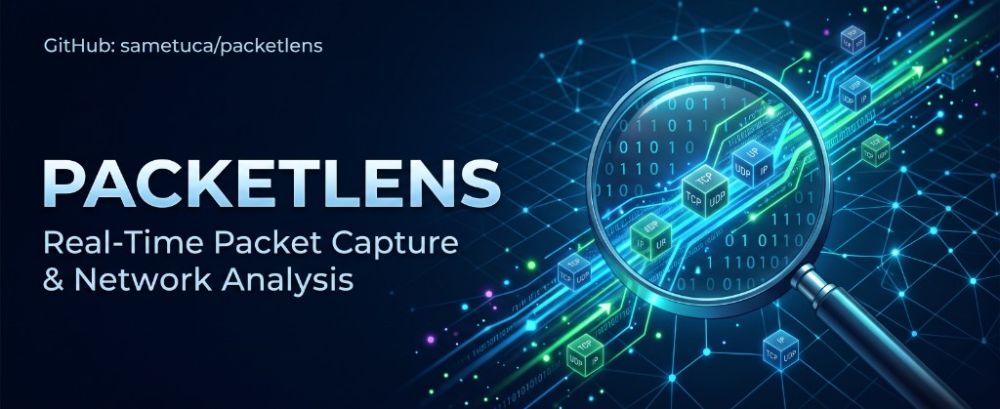
</p>

# PacketLens

**English** · [Türkçe](README.tr.md)

A Wireshark-style packet analyzer that is much easier to use. PacketLens groups traffic into applications, connections, devices and **problems**, and explains them in plain language.
Built for Kali Linux with **zero dependencies** (Python 3 only). No Wireshark, tshark or libpcap needed.

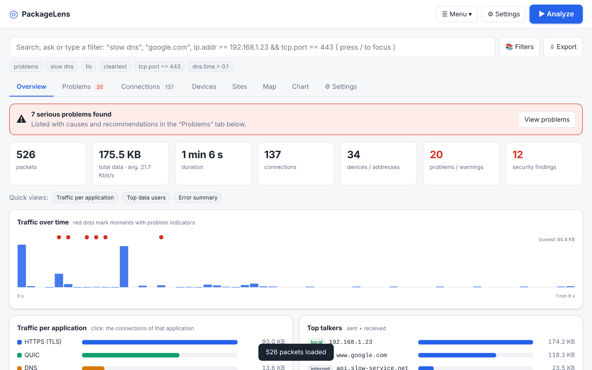

## Quick start

```bash
git clone https://github.com/sametuca/packetlens.git
cd packetlens
sudo python3 packetlens.py          # live capture + GUI (opens in your browser)
python3 packetlens.py --no-capture  # no root: analyze .pcap files only (works on macOS too)
```

If the browser does not open, use the full **`http://127.0.0.1:8765/?t=...`** URL from the terminal (the `?t=` session token is required). If the token is missing, the server redirects automatically.

**macOS:** double-click **`start.command`** in the project folder instead of typing commands — it starts the server and opens your browser at the right URL automatically. Do not double-click `index.html` directly: that opens the page without a server (`file://`) and live analysis will not work.

**Linux (Kali, etc.):** double-click **`start.sh`** in your file manager (choose "Run" / "Run in Terminal") instead of typing commands — it asks for your sudo password for live capture and opens your browser automatically; without root it falls back to file analysis. Run `./install-desktop-launcher.sh` once to add a proper **PacketLens** icon to your Applications menu (and Desktop).
Options: `-i eth0` (default interface), `--port 9000`, `--no-browser`, `--scan-interval MIN` (scheduled ARP scan, root).
You can open `index.html` directly and load a `.pcap` / `.pcapng` without the server (no live capture or ptentes).
On macOS/Windows there is no live packet capture; use `python3 packetlens.py --no-capture` for file analysis.
Open the **☰ Menu → Load sample** to try the app with a built-in capture.

## Analyze your own network

Press the big **▶ Analyze** button (always visible in the header). Pick a network **adapter** like in Wireshark – each card shows type (Ethernet / Wi-Fi / virtual), link state, IPv4/mask, MAC, speed, traffic counters and which one carries your internet route – optionally add a capture filter, and start. Capture stops automatically after the duration or packet limit you set in Settings.

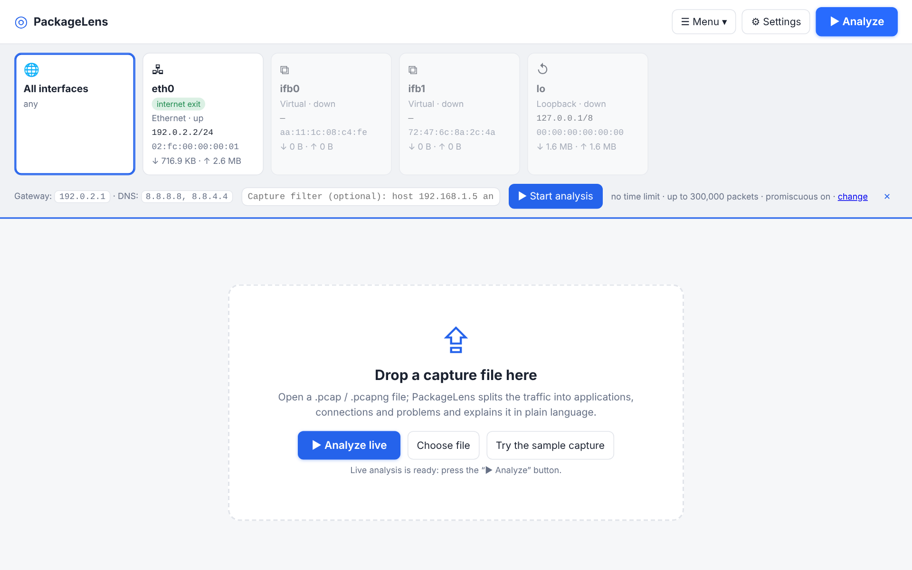

The **Devices** tab lists every machine on the local network: IP, MAC, vendor (from the MAC prefix), role (this computer, gateway, DNS/DHCP server), OS guess, data sent/received, connections, top applications and last-seen time. During live analysis this computer's ARP table adds devices that were silent during the capture.

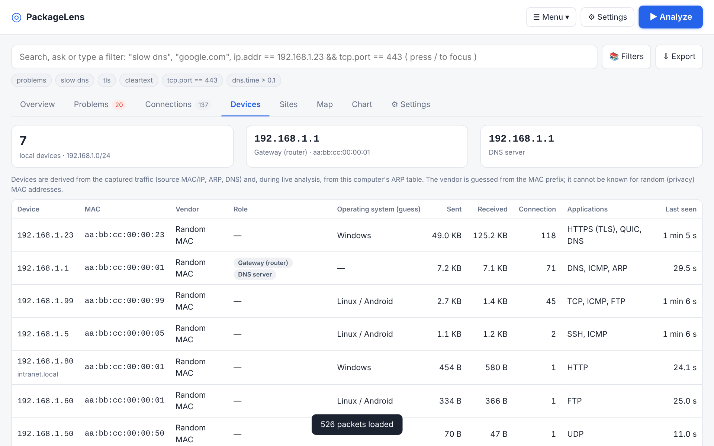

## Features

**Easy to use**
- **Simple / Advanced mode:** Simple shows Summary, Problems, Connections, Devices, Sites, Map and Chart; Advanced adds Packets, Statistics and Logs.
- **English / Turkish UI**, light / dark / auto theme, compact density, absolute / relative time columns (☰ Menu and Settings).
- **Natural-language search:** queries like `slow dns`, `192.168.1.23 error`, `port 443`, `google.com`. The equivalent Wireshark filter is shown below the box. Press `/` to focus search.
- Every problem comes with a cause and a "what to do" hint; every packet has a plain-language explanation.
- IPs are resolved to names from DNS answers, TLS SNI and HTTP Host headers.

**Settings tab** – tune detection thresholds (slow DNS, slow handshake, retransmissions, scan targets…), switch individual detections on/off, set capture defaults (adapter, capture filter, snap length, packet limit, auto-stop, promiscuous mode), choose how names and times are shown, save your own filters, and import / export / reset all settings.

**Wireshark core**
- **Display filter language:** `ip.addr == 192.168.1.0/24 && tcp.port == 443`, `dns.qry.name contains "google"`, `tcp.analysis.retransmission`, `!`, `matches`, parentheses. Errors are explained.
- **BPF capture filter** (live capture): `host 192.168.1.5 and port 443`, `not port 22`, `tcp or udp`, `net 10.0.0.0/8`, `portrange 20-25`, `less/greater N`.
- **Follow TCP/UDP stream** (client in blue, server in red; ASCII/Hex; copy/download).
- **Charts** colored by app; **drag to select a time range** and every tab filters to it.
- **Statistics:** protocol hierarchy, packet sizes, conversations, hosts, TCP handshake times, DNS and HTTP summaries.
- **Logs:** DNS, HTTP, TLS (version, cipher, ALPN, certificate), cleartext sessions, extracted files.
- Packet list, layer tree, hex view, `.pcap` / `.pcapng` reading and `.pcap` saving.

**Things people look for in Wireshark but cannot find**
- **Filter library (📚):** 32 ready-made, validated display filters (HTTP errors, retransmissions, scans, cleartext logins, …) plus your own saved filters.
- **Sites view:** which sites/domains each device visited, even when the content is encrypted (DNS, TLS SNI, HTTP Host).
- **HTTP file extraction:** files transferred over plain HTTP are reassembled, type-detected by magic bytes (executables are flagged) and downloadable.
- **Content search:** find a string / regex / hex pattern across all packet payloads and jump to the hit.
- **Notes** on any connection that end up in the report.
- **Export:** self-contained HTML report, `.pcap`, **anonymized `.pcap`** (consistent MAC/IP masking, optional payload wiping, checksums recomputed) and CSV for packets, connections, problems, sites, DNS, HTTP and TLS, plus JSON.

**Visualization**
- **Network map:** who talks to whom (circle size = data, red = problems); click a host to focus on it.
- **Sequence diagram** per connection and a **TLS detail panel**.

**Security (Kali)**
- Cleartext credentials: HTTP Basic/form, FTP, POP3, IMAP, SMTP AUTH, Telnet. **Passwords are masked**; full passwords are never stored.
- ARP spoofing, DNS tunneling, DGA-like NXDOMAIN bursts, beaconing, port/ping scans, SYN flood, weak/old TLS, cleartext protocol use.
- OS guess from TTL and TCP options (heuristic only).
- Problems are split into **Security / Performance / Network**.

**ptentes (MITM)**
- Places the target between your machine and the gateway via ARP spoofing; traffic keeps flowing while you observe.
- Cleartext HTTP (Host, path, User-Agent, Basic auth, forms), TLS SNI, QUIC SNI, DNS queries and Set-Cookie in the live panel.
- DNS map can spoof answers for chosen names (`example.com=192.168.1.50`).
- Local ARP discovery; JSON report for credentials, cookies, events and hosts. Details: [docs/ptentes.md](docs/ptentes.md).
- On stop, ARP entries and `ip_forward` are restored.

## Recent updates · Son güncellemeler

| English | Türkçe |
|---------|--------|
| **Devices:** mobile hints (mDNS, DHCP, vendor, QUIC), “Mobile only” filter, **mobile report CSV**, ARP/ping/port scan, scan compare, playbooks. | **Cihazlar:** mobil tanıma, “Yalnızca mobil” filtresi, **Mobil rapor .csv**, ARP/ping/port tarama, karşılaştırma, playbook’lar. |
| **Guest Wi‑Fi:** possible AP isolation hint, captive portal / HTTP User-Agent alerts. | **Misafir Wi‑Fi:** AP izolasyonu ipucu, captive portal / User-Agent uyarıları. |
| **Passive TLS/QUIC (`tlspassive.js`):** QUIC SNI, ECH detection, JA3 (MD5) + JA4, cert SAN/validity, inspection CA / issuer mismatch (no decryption). | **Pasif TLS/QUIC:** QUIC SNI, ECH, JA3/JA4, sertifika alanları, issuer anomalisi (içerik yok). |
| **DoH/DoT** in Sites and Problems. | **DoH/DoT** Siteler ve Sorunlar’da. |
| **ptentes:** multi-target, session label/note, cookies, QUIC/ECH KPIs, Sites tab, watch in capture, MITM checklist. | **ptentes:** çoklu hedef, etiket/not, çerezler, QUIC/ECH, Siteler, yakalamada izle, hazırlık listesi. |
| **Server:** device registry API, webhook, `oui.json`; token redirect and clearer connection errors. | **Sunucu:** cihaz API, webhook, `oui.json`; token yönlendirme ve bağlantı mesajları. |
| **Export:** Devices + mobile CSV; TLS CSV with JA3/JA4/ECH/QUIC. | **Dışa aktarma:** Cihazlar + mobil rapor; geniş TLS CSV. |

## Screenshots

| | |
|---|---|
| 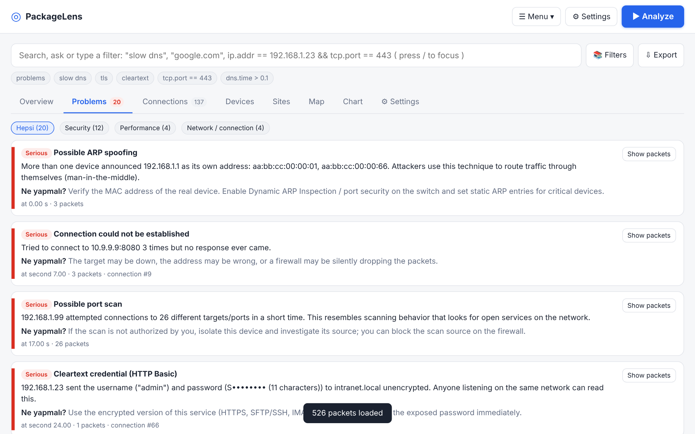<br>Problems, grouped by category | 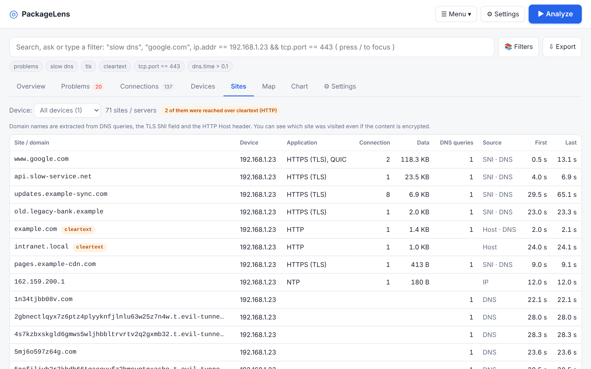<br>Sites each device visited |
| 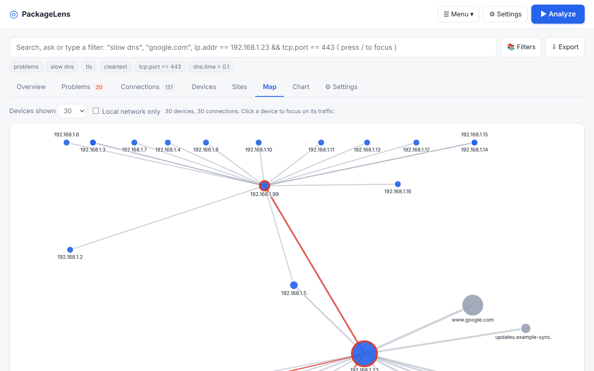<br>Network map | 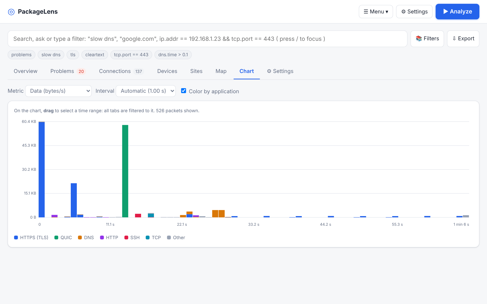<br>Traffic chart with drag-to-select |
| 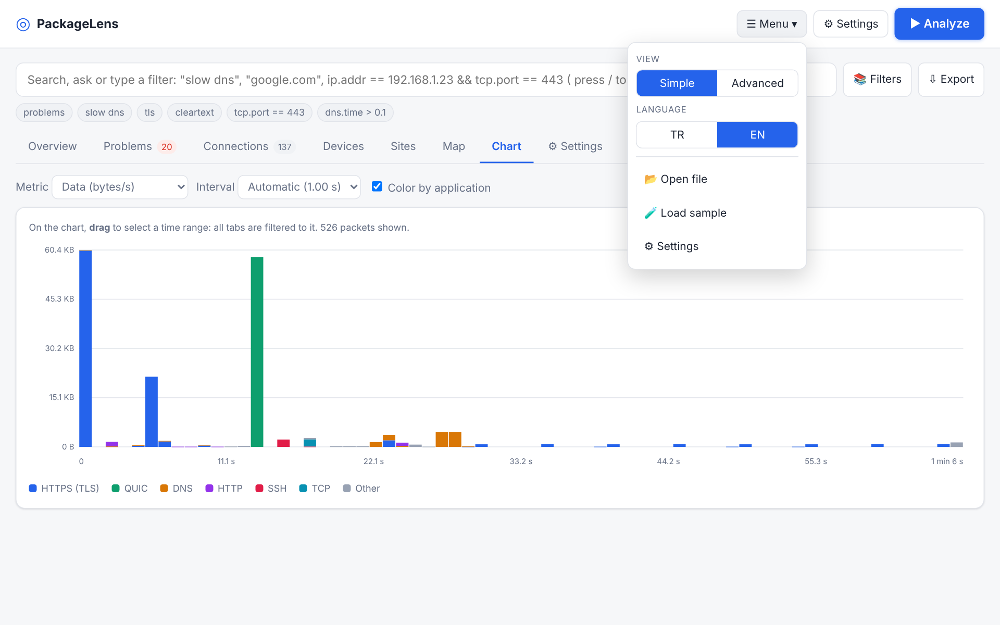<br>Menu: view mode, language, open file, sample | 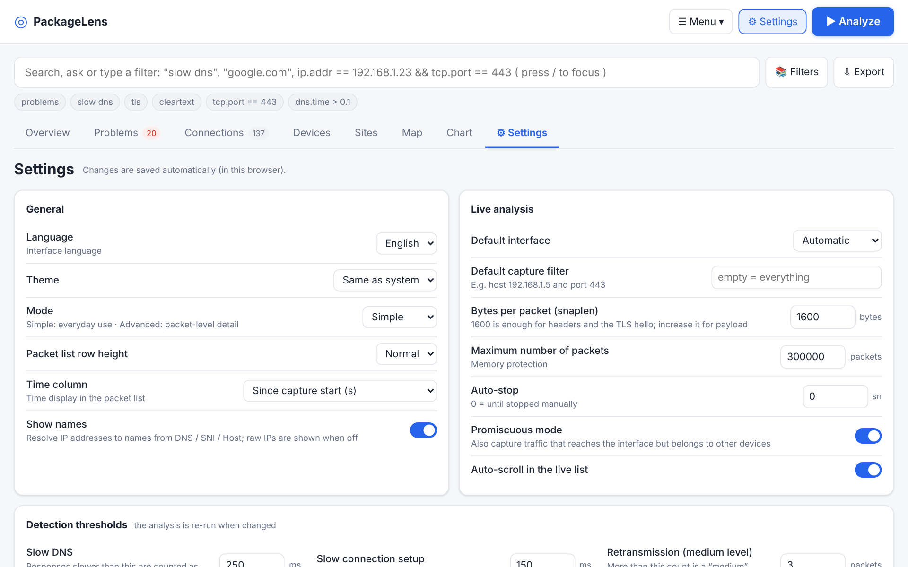<br>Settings |
| 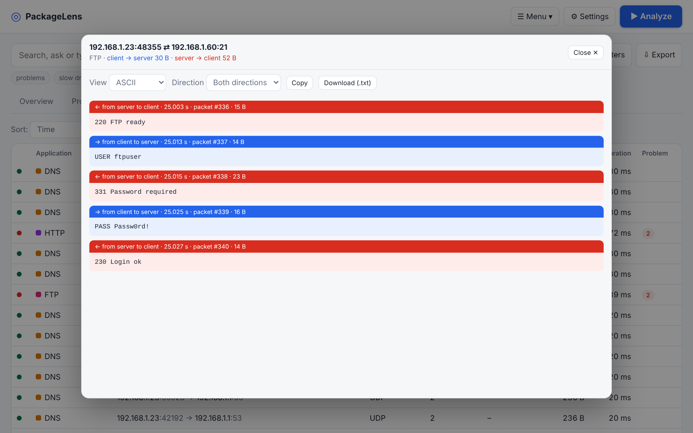<br>Follow stream (cleartext FTP) | 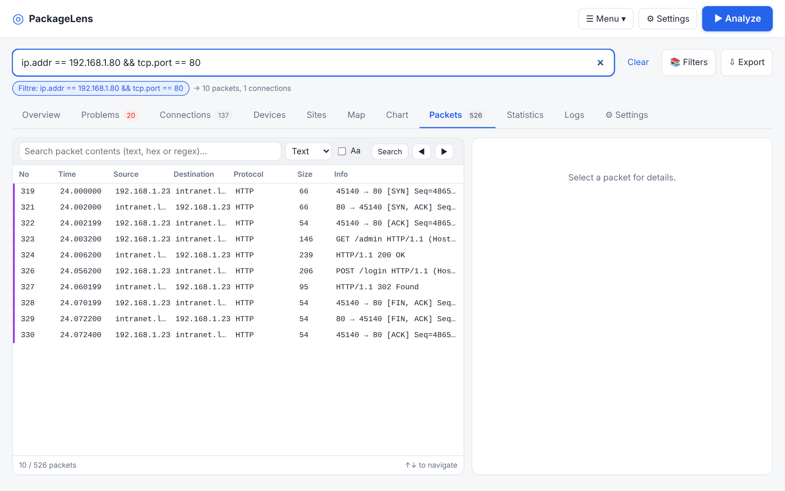<br>Display filter |
| 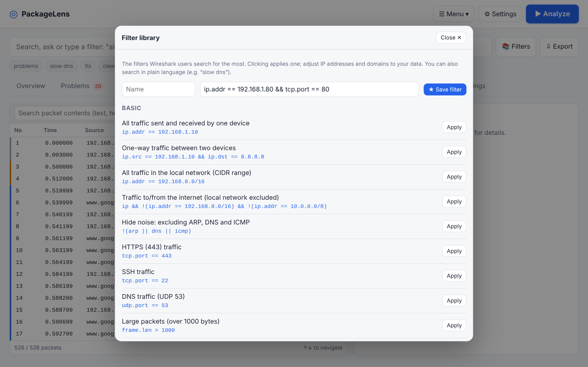<br>Filter library | 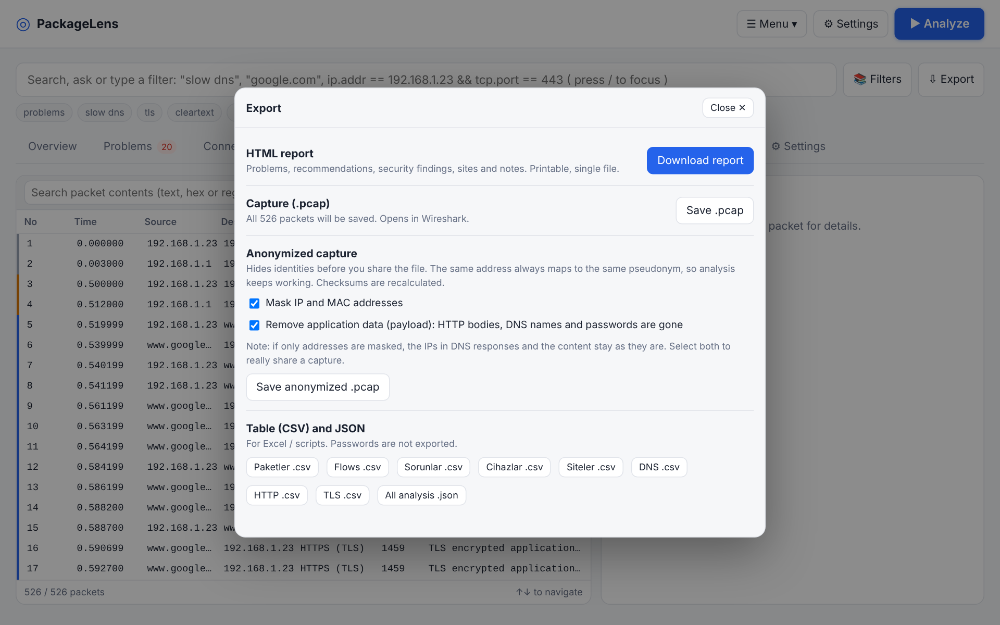<br>Export, report and anonymization |

## Security notes

The server listens on `127.0.0.1` only, requires a random access token and validates the `Host` header (DNS-rebinding protection).
Live capture needs root. **Use it only on networks you are authorized to monitor.** Anonymized exports mask addresses but are not a guarantee of privacy; review them before sharing.

## Project layout

| File | Purpose |
|---|---|
| `packetlens.py` | Local server + live capture (AF_PACKET), adapter/network info, device APIs |
| `deviceintel.py` | ARP/ping/port scan, device registry, history, compare, webhook |
| `ptentes.py` | MITM engine: ARP spoofing, HTTP/TLS/QUIC/DNS inspection, DNS redirection, discovery |
| `tlspassive.js` | JA3/JA4, ECH, QUIC SNI, certificate parsing, DoH list, issuer anomaly hints |
| `ptentes-ui.js` | ptentes control panel (session, live feed, credentials, DNS, hosts) |
| `capfilter.py` | BPF capture filter (host/net/port/proto, and/or/not) |
| `parser.js` | pcap/pcapng reader, protocol dissection, flow and problem analysis |
| `filter.js` | Wireshark-style display filter language |
| `extras.js` | Stream following, logs, statistics, security detections |
| `tools.js` | pcap writer, anonymizer, sites, HTTP file extraction, devices, CSV, filter library |
| `features.js` | Settings, Devices, Sites, files, notes, search, export dialogs |
| `i18n.js`, `lang-en.js` | Language support (Turkish source text, English dictionary) |
| `app.js`, `views.js`, `index.html`, `style.css` | User interface |
| `gen_sample.py` | Generates `sample.pcap` / `sample.js` (demo scenarios) |

## Tests

```bash
python3 gen_sample.py        # regenerate the sample capture
node test_parser.js          # dissector
node test_filter.js          # display filter
node test_tools.js           # anonymizer (checksums), sites, files, devices, CSV, filter library
python3 test_capfilter.py    # BPF filter (cross-checked against the JS engine)
```

## Known limitations

- Encrypted content (TLS/QUIC) is not decrypted; you still see who talks to whom, which site (SNI), how much, and with what problems.
- With TLS 1.3 the certificate is encrypted, so certificate details only appear for TLS 1.2 and earlier.
- Live capture keeps the first 1600 bytes per packet by default and at most 300k packets (both adjustable in Settings).
- The capture filter is a common subset of tcpdump/BPF syntax (no hostname resolution, no `ether`/`vlan`).
- Live capture and the adapter list work on Linux only.
- Vendor names use a built-in table plus `oui.json`; random (privacy) MACs have no vendor.
- With ECH enabled the real site name may be hidden; QUIC SNI can be missing on fragmented ClientHello.
- “User CA installed?” cannot be proven from the network alone; only certificate/issuer anomaly hints (no fake CA / SSL strip).
