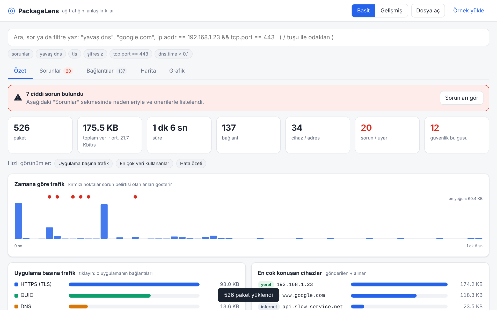
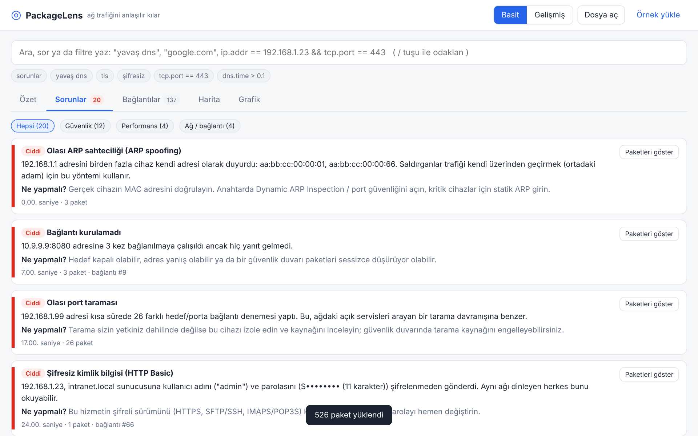
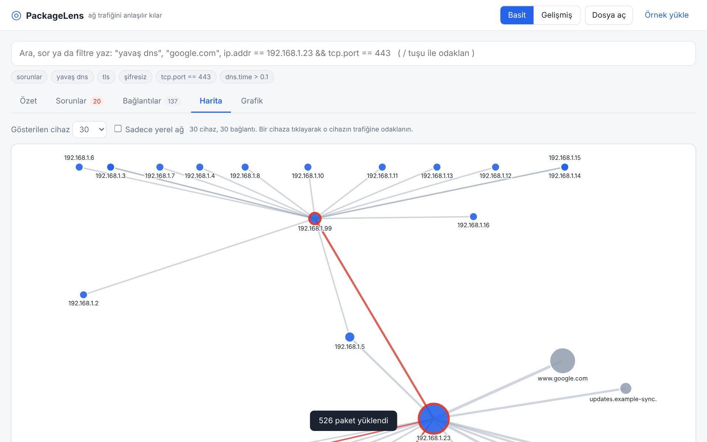
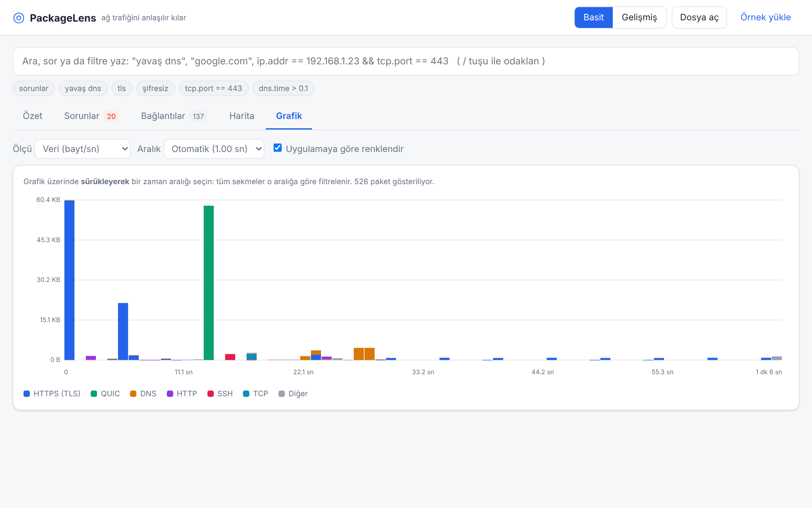
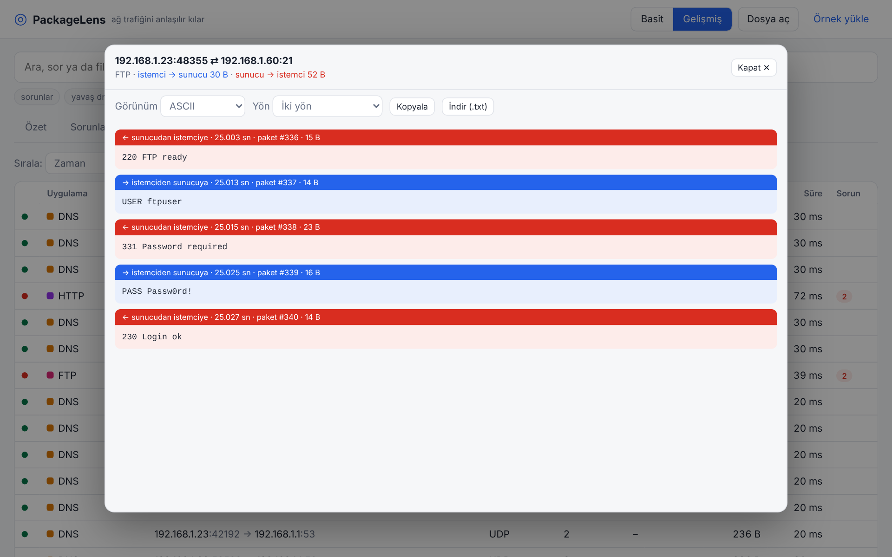
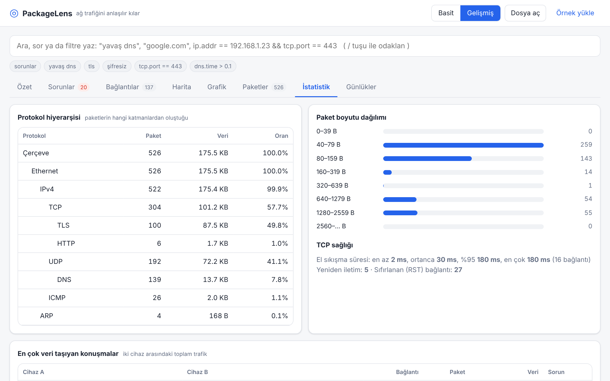
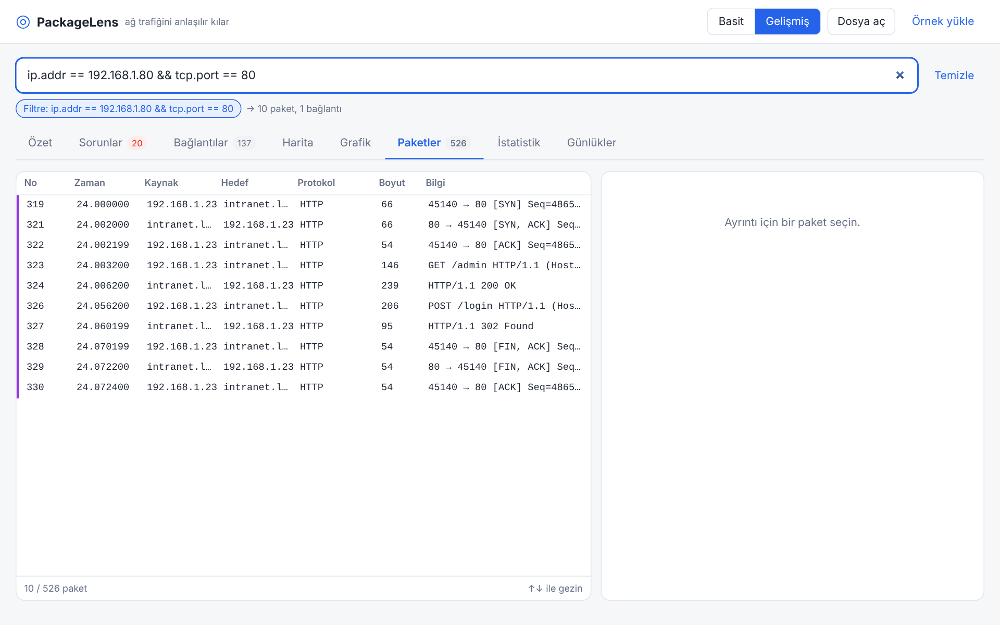

# PackageLens

**English** · [Türkçe](README.tr.md)

A Wireshark-style packet analyzer that is much easier to use. PackageLens groups traffic into applications, connections and **problems**, and explains them in plain language.
Built for Kali Linux with **zero dependencies** (Python 3 only). No Wireshark, tshark or libpcap needed.



> The interface is currently in Turkish. English UI strings are planned.

## Quick start

```bash
git clone https://github.com/sametuca/packagelens.git
cd packagelens
sudo python3 packagelens.py          # live capture + GUI (opens in your browser)
python3 packagelens.py --no-capture  # no root: analyze .pcap files only (works on macOS too)
```

If the browser does not open, use the `http://127.0.0.1:8765/?t=...` address printed in the terminal.
Options: `-i eth0` (interface), `--port 9000`, `--no-browser`.
You can also open `index.html` directly and load a `.pcap` / `.pcapng` file without the server.
Click **"Örnek yükle"** (load sample) to try the app with a built-in capture.

## Features

**Easy to use**
- **Simple / Advanced mode:** Simple shows Overview, Problems, Connections, Map and Chart; Advanced adds Packets, Statistics and Logs.
- **Natural-language search:** queries like `slow dns`, `192.168.1.23 error`, `port 443`, `google.com`. The equivalent Wireshark filter is shown below the box. Press `/` to focus search.
- Every problem comes with a cause and a "what to do" hint; every packet has a plain-language explanation.
- IPs are resolved to names from DNS answers, TLS SNI and HTTP Host headers.

**Wireshark core**
- **Display filter language:** `ip.addr == 192.168.1.0/24 && tcp.port == 443`, `dns.qry.name contains "google"`, `tcp.analysis.retransmission`, `!`, `matches`, parentheses. Errors are explained with similar-field suggestions.
- **BPF capture filter** (live capture): `host 192.168.1.5 and port 443`, `not port 22`, `tcp or udp`, `net 10.0.0.0/8`, `portrange 20-25`, `less/greater N`.
- **Follow TCP/UDP stream** (client in blue, server in red; ASCII/Hex; copy/download).
- **Charts** (bytes/s, packets/s, problems, retransmissions) colored by app; **drag to select a time range** and every tab filters to it.
- **Statistics:** protocol hierarchy, packet sizes, conversations, hosts, TCP handshake times, DNS and HTTP summaries.
- **Logs:** DNS, HTTP (request/response matched), TLS (version, cipher, ALPN, certificate), cleartext sessions.
- Packet list, layer tree, hex view, `.pcap` / `.pcapng` reading and `.pcap` saving.

**Visualization**
- **Network map:** who talks to whom (circle size = data, red = problems); click a host to focus on it.
- **Sequence diagram** per connection and a **TLS detail panel**.

**Security (Kali)**
- Cleartext credentials: HTTP Basic/form, FTP, POP3, IMAP, SMTP AUTH, Telnet. **Passwords are masked**; full passwords are never stored.
- ARP spoofing, DNS tunneling, DGA-like NXDOMAIN bursts, beaconing, port/ping scans, SYN flood, weak/old TLS, cleartext protocol use.
- OS guess from TTL and TCP options (heuristic only).
- Problems are split into **Security / Performance / Network**.

## Screenshots

| | |
|---|---|
| <br>Problems, grouped by category | <br>Network map |
| <br>Traffic chart with drag-to-select | <br>Follow stream (cleartext FTP) |
| <br>Statistics | <br>Display filter |

## Security notes

The server listens on `127.0.0.1` only, requires a random access token and validates the `Host` header (DNS-rebinding protection).
Live capture needs root. **Use it only on networks you are authorized to monitor.**

## Project layout

| File | Purpose |
|---|---|
| `packagelens.py` | Local server + live capture (AF_PACKET) |
| `capfilter.py` | BPF capture filter (host/net/port/proto, and/or/not) |
| `parser.js` | pcap/pcapng reader, protocol dissection, flow and problem analysis |
| `filter.js` | Wireshark-style display filter language |
| `extras.js` | Stream following, logs, statistics, security detections |
| `app.js`, `views.js`, `index.html`, `style.css` | User interface |
| `gen_sample.py` | Generates `sample.pcap` / `sample.js` (demo scenarios) |

## Tests

```bash
python3 gen_sample.py        # regenerate the sample capture
node test_parser.js          # dissector
node test_filter.js          # display filter
python3 test_capfilter.py    # BPF filter (cross-checked against the JS engine)
```

## Known limitations

- Encrypted content (TLS/QUIC) is not decrypted; you still see who talks to whom, which site (SNI), how much, and with what problems.
- With TLS 1.3 the certificate is encrypted, so certificate details only appear for TLS 1.2 and earlier.
- Live capture keeps the first 1600 bytes per packet and at most 300k packets (memory guard).
- The capture filter is a common subset of tcpdump/BPF syntax (no hostname resolution, no `ether`/`vlan`).
- Live capture works on Linux only.
