# PackageLens

[English](README.md) · **Türkçe**

Wireshark tarzı ama çok daha kolay: paketleri uygulamalara, bağlantılara, cihazlara ve **sorunlara** ayırır, düz Türkçe ile anlatır.
Kali Linux için hazırlandı; **bağımlılık yok** (sadece Python 3). Wireshark, tshark veya libpcap gerekmez.

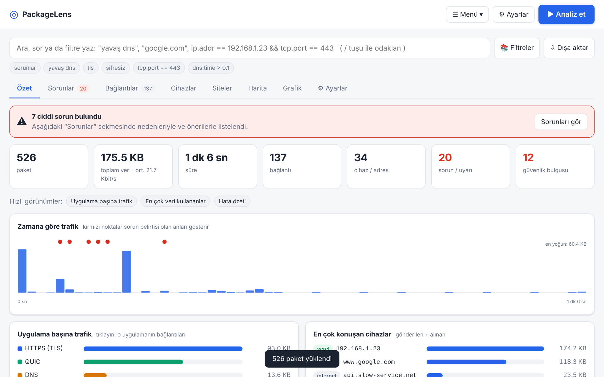

## Hızlı başlangıç

```bash
git clone https://github.com/sametuca/packagelens.git
cd packagelens
sudo python3 packagelens.py          # canlı yakalama + arayüz (tarayıcı otomatik açılır)
python3 packagelens.py --no-capture  # root olmadan, sadece .pcap analizi (macOS'ta da çalışır)
```

Tarayıcı açılmazsa terminalde yazan `http://127.0.0.1:8765/?t=...` adresini açın.
Seçenekler: `-i eth0` (varsayılan arayüz), `--port 9000`, `--no-browser`.
Sunucu olmadan `index.html` dosyasını doğrudan açıp `.pcap` / `.pcapng` yükleyebilirsiniz.
Uygulamayı denemek için **☰ Menü → Örnek yükle**.

## Kendi ağınızı analiz edin

Başlıktaki her zaman görünür büyük **▶ Analiz et** düğmesine basın. Wireshark'taki gibi bir **ağ adaptörü** seçin: her kart türü (Ethernet / Wi-Fi / sanal), bağlantı durumunu, IPv4/maske, MAC, hızı, trafik sayaçlarını ve internet çıkışı olan adaptörü gösterir. İsterseniz yakalama filtresi ekleyip başlatın. Yakalama, Ayarlar'da belirlediğiniz süre veya paket sınırında kendiliğinden durur.

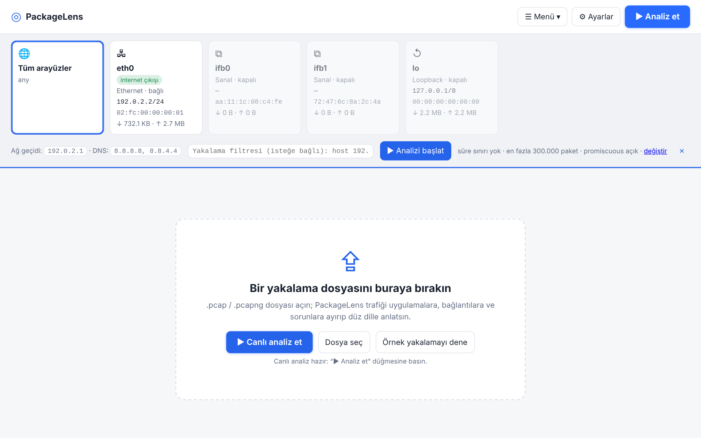

**Cihazlar** sekmesi yerel ağdaki her makineyi listeler: IP, MAC, üretici (MAC önekinden), rol (bu bilgisayar, ağ geçidi, DNS/DHCP sunucusu), işletim sistemi tahmini, gönderilen/alınan veri, bağlantılar, öne çıkan uygulamalar ve son görülme. Canlı analizde bu bilgisayarın ARP tablosu, yakalama sırasında sessiz kalan cihazları da ekler.

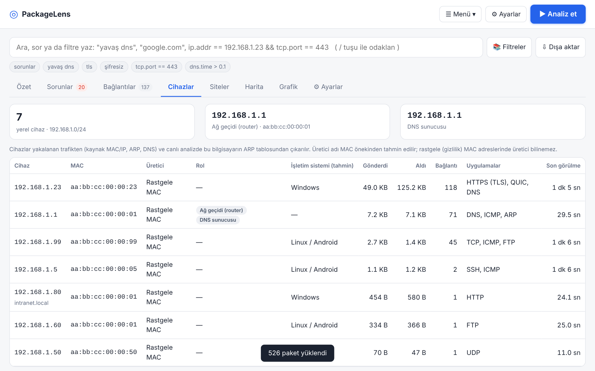

## Özellikler

**Kolay kullanım**
- **Basit / Gelişmiş mod:** Basit modda Özet, Sorunlar, Bağlantılar, Cihazlar, Siteler, Harita ve Grafik; Gelişmiş modda ayrıca Paketler, İstatistik ve Günlükler.
- **Türkçe / İngilizce arayüz**, açık / koyu / otomatik tema, sıkı yerleşim, göreli / mutlak zaman sütunları (☰ Menü ve Ayarlar).
- **Doğal dil araması:** `yavaş dns`, `192.168.1.23 hata`, `port 443`, `google.com`. Karşılık gelen Wireshark filtresi kutunun altında gösterilir. `/` tuşu aramaya odaklanır.
- Her sorunun nedeni ve "ne yapmalı" önerisi vardır; her paketin düz dille açıklaması vardır.
- IP adresleri DNS yanıtlarından, TLS SNI ve HTTP Host başlığından isme çevrilir.

**Ayarlar sekmesi** – algılama eşiklerini (yavaş DNS, yavaş el sıkışma, yeniden iletim, tarama hedefleri…) değiştirin, tek tek algılamaları açıp kapatın, yakalama varsayılanlarını (adaptör, yakalama filtresi, paket boyu, paket sınırı, otomatik durdurma, promiscuous mod) belirleyin, isim ve zaman gösterimini seçin, kendi filtrelerinizi kaydedin; tüm ayarları içe/dışa aktarın veya sıfırlayın.

**Wireshark çekirdeği**
- **Görüntüleme filtresi dili:** `ip.addr == 192.168.1.0/24 && tcp.port == 443`, `dns.qry.name contains "google"`, `tcp.analysis.retransmission`, `!`, `matches`, parantez. Hatalar açıklanır.
- **BPF yakalama filtresi** (canlı): `host 192.168.1.5 and port 443`, `not port 22`, `tcp or udp`, `net 10.0.0.0/8`, `portrange 20-25`, `less/greater N`.
- **TCP/UDP akışı takibi** (istemci mavi, sunucu kırmızı; ASCII/Hex; kopyala/indir).
- Uygulamaya göre renkli **grafikler**; **sürükleyerek zaman aralığı seçin**, tüm sekmeler o aralığa göre süzülür.
- **İstatistik:** protokol hiyerarşisi, paket boyutları, konuşmalar, makineler, TCP el sıkışma süreleri, DNS ve HTTP özetleri.
- **Günlükler:** DNS, HTTP, TLS (sürüm, şifre, ALPN, sertifika), şifresiz oturumlar, çıkarılan dosyalar.
- Paket listesi, katman ağacı, hex görünümü, `.pcap` / `.pcapng` okuma ve `.pcap` kaydetme.

**Wireshark'ta aranıp bulunamayanlar**
- **Filtre kütüphanesi (📚):** 32 hazır, doğrulanmış görüntüleme filtresi (HTTP hataları, yeniden iletim, taramalar, şifresiz girişler…) ve kendi kayıtlı filtreleriniz.
- **Siteler görünümü:** içerik şifreli olsa bile hangi cihazın hangi siteye gittiği (DNS, TLS SNI, HTTP Host).
- **HTTP dosya çıkarma:** şifresiz HTTP ile aktarılan dosyalar yeniden birleştirilir, sihirli baytlarla türü saptanır (çalıştırılabilirler işaretlenir) ve indirilebilir.
- **İçerik araması:** tüm paket yüklerinde metin / regex / hex deseni arayıp sonuca atlayın.
- Her bağlantıya rapora giren **notlar**.
- **Dışa aktarma:** tek dosya HTML rapor, `.pcap`, **anonimleştirilmiş `.pcap`** (tutarlı MAC/IP maskeleme, isteğe bağlı yük silme, sağlama toplamları yeniden hesaplanır), paketler/bağlantılar/sorunlar/siteler/DNS/HTTP/TLS için CSV ve JSON.

**Görselleştirme**
- **Ağ haritası:** kim kiminle konuşuyor (daire boyutu = veri, kırmızı = sorun); bir makineye tıklayıp odaklanın.
- Bağlantı başına **sıra diyagramı** ve **TLS ayrıntı paneli**.

**Güvenlik (Kali)**
- Şifresiz kimlik bilgileri: HTTP Basic/form, FTP, POP3, IMAP, SMTP AUTH, Telnet. **Parolalar maskelenir**; tam parola saklanmaz.
- ARP sahteciliği, DNS tünelleme, DGA benzeri NXDOMAIN patlamaları, beaconing, port/ping taraması, SYN flood, zayıf/eski TLS, şifresiz protokol kullanımı.
- TTL ve TCP seçeneklerinden işletim sistemi tahmini (sezgisel).
- Sorunlar **Güvenlik / Performans / Ağ** olarak ayrılır.

## Ekran görüntüleri

| | |
|---|---|
| 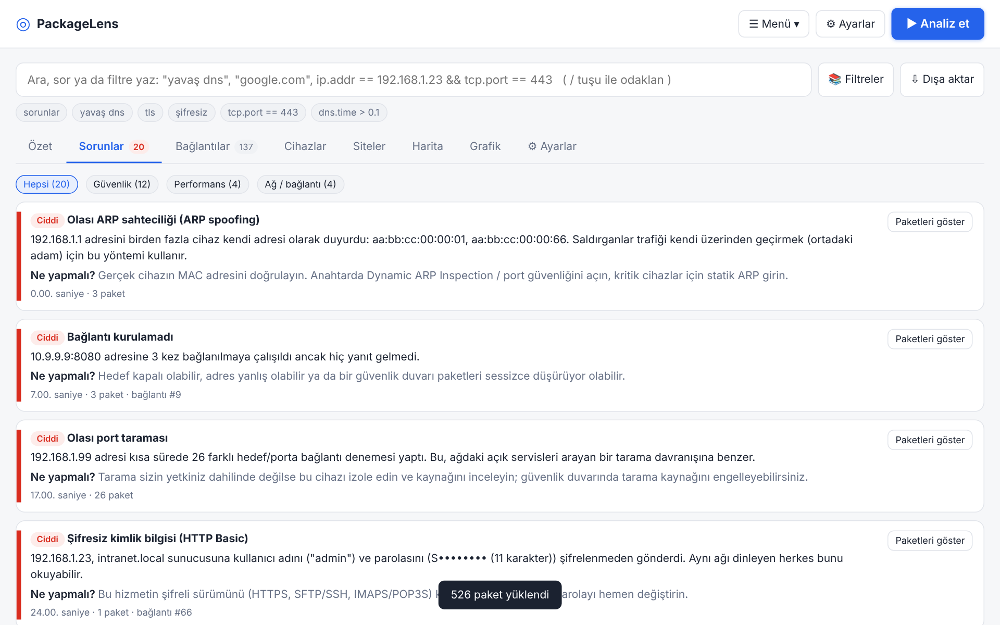<br>Sorunlar, kategoriye göre | 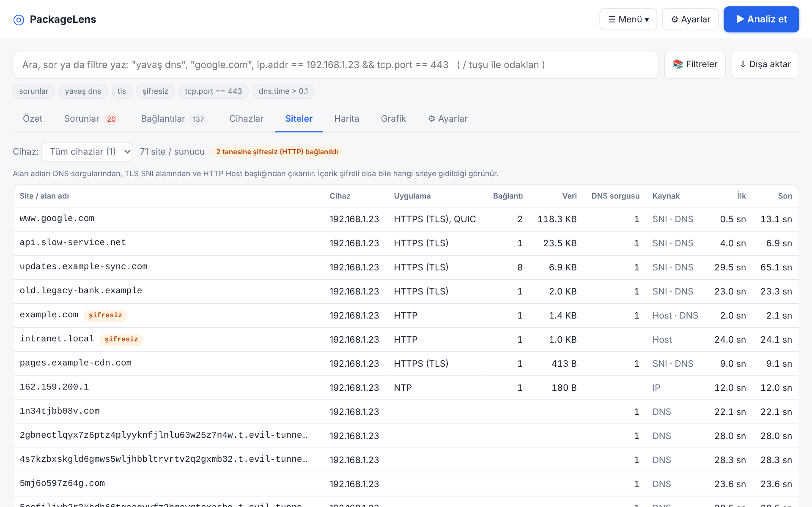<br>Cihazların gittiği siteler |
| 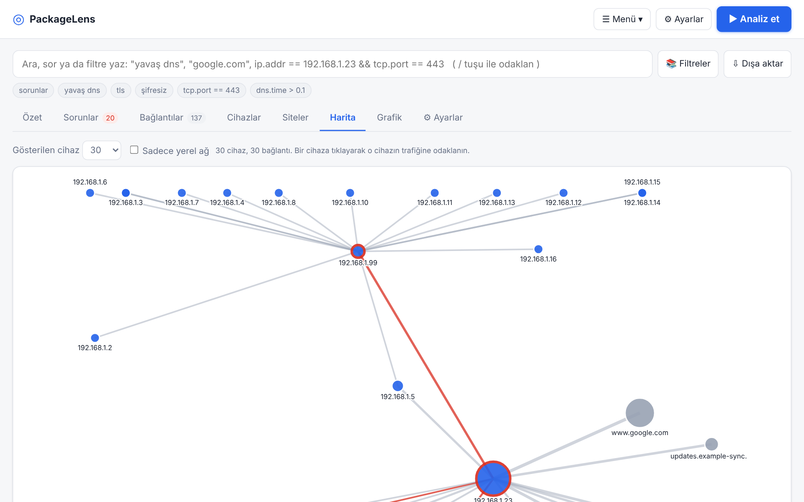<br>Ağ haritası | 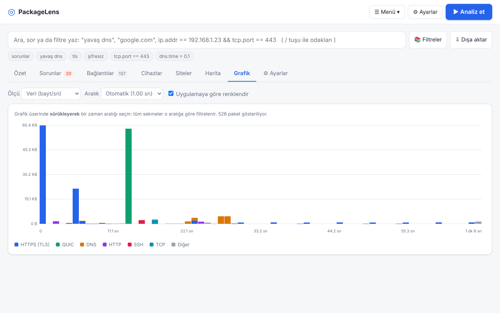<br>Sürükleyerek seçilen trafik grafiği |
| 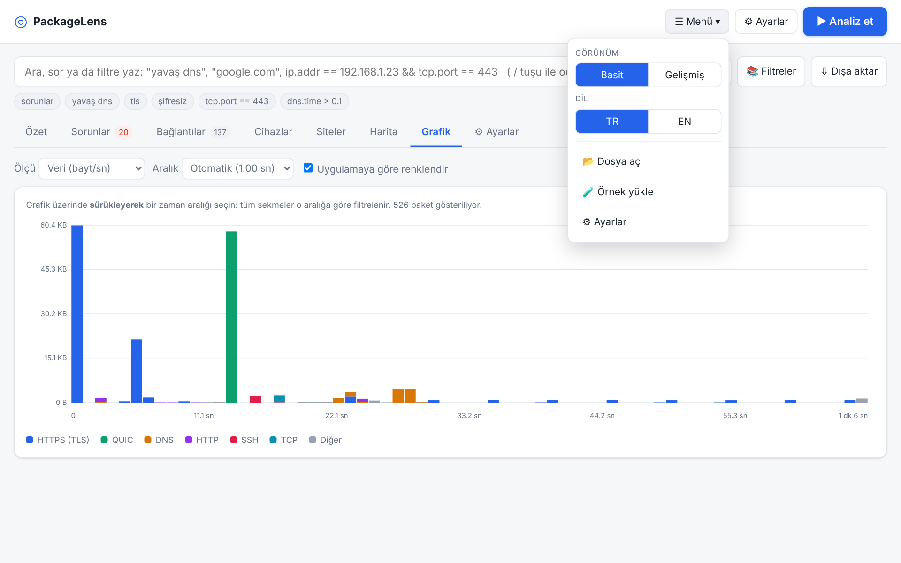<br>Menü: mod, dil, dosya aç, örnek | 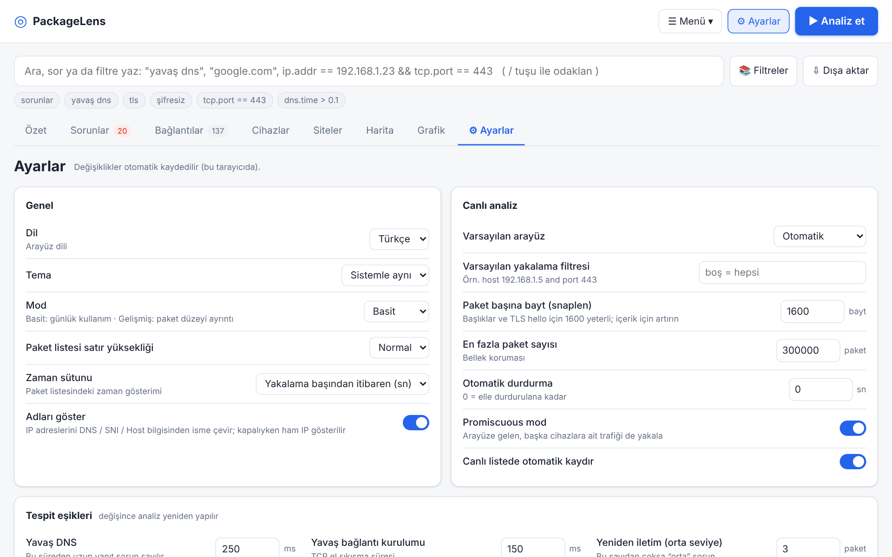<br>Ayarlar |
| 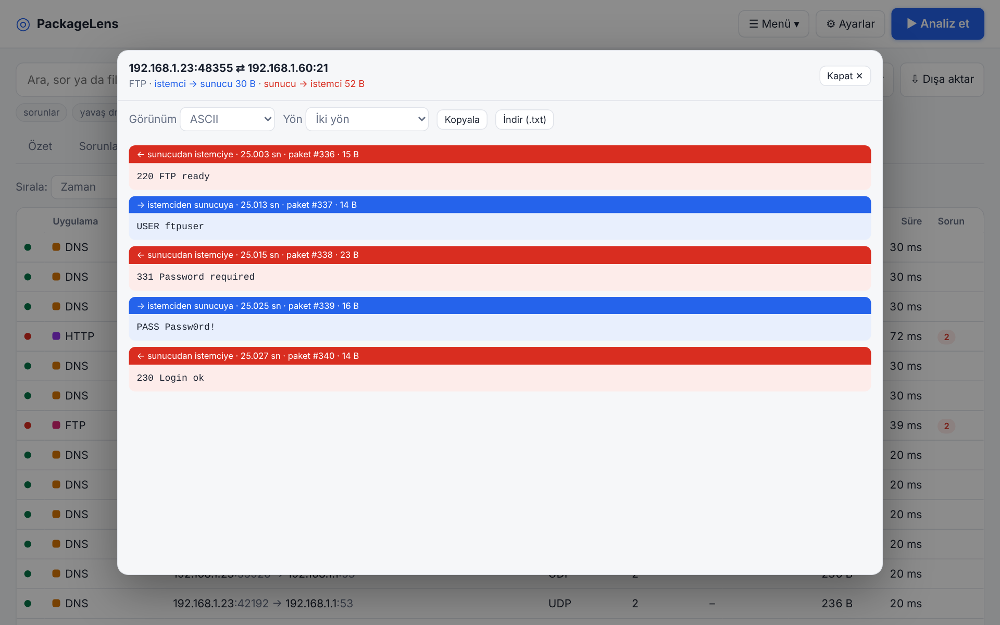<br>Akış takibi (şifresiz FTP) | 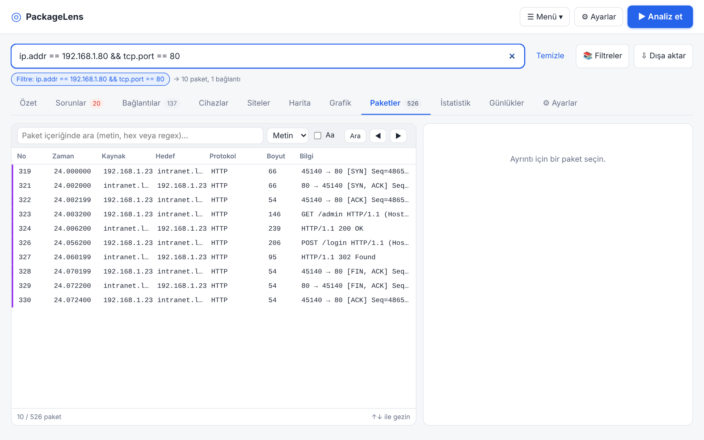<br>Görüntüleme filtresi |
| 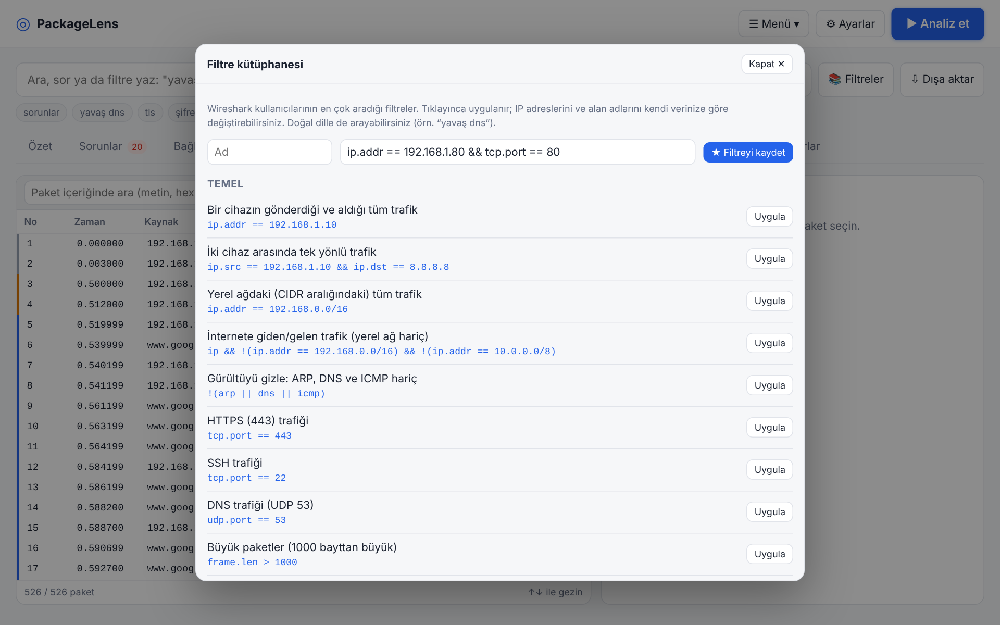<br>Filtre kütüphanesi | 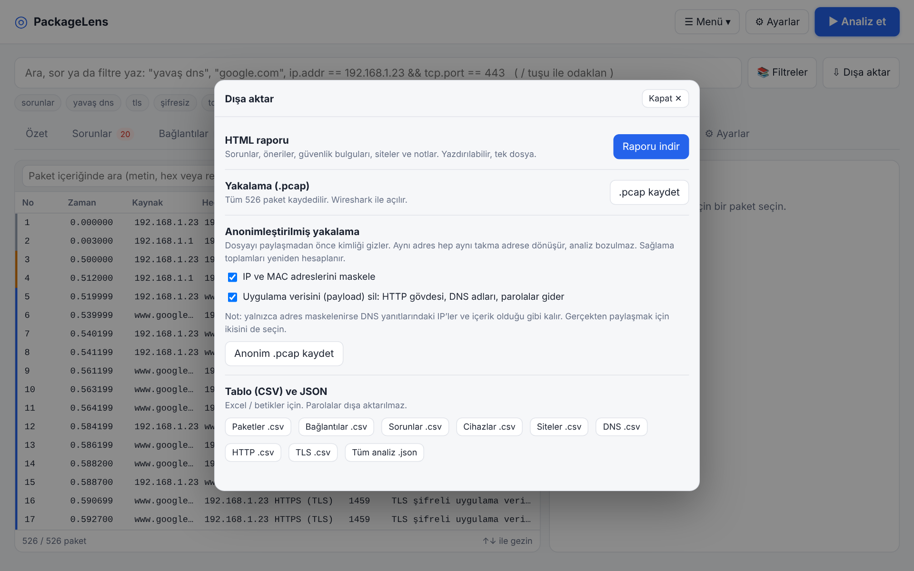<br>Dışa aktarma, rapor ve anonimleştirme |

## Güvenlik notları

Sunucu yalnızca `127.0.0.1` üzerinde dinler, rastgele bir erişim anahtarı ister ve `Host` başlığını doğrular (DNS-rebinding koruması).
Canlı yakalama root gerektirir. **Yalnızca izleme yetkiniz olan ağlarda kullanın.** Anonimleştirilmiş çıktı adresleri maskeler ama gizlilik garantisi değildir; paylaşmadan önce gözden geçirin.

## Proje yapısı

| Dosya | Görev |
|---|---|
| `packagelens.py` | Yerel sunucu + canlı yakalama (AF_PACKET), adaptör ve ağ bilgisi |
| `capfilter.py` | BPF yakalama filtresi (host/net/port/proto, and/or/not) |
| `parser.js` | pcap/pcapng okuyucu, protokol çözümleme, akış ve sorun analizi |
| `filter.js` | Wireshark tarzı görüntüleme filtresi dili |
| `extras.js` | Akış takibi, günlükler, istatistik, güvenlik algılamaları |
| `tools.js` | pcap yazıcı, anonimleştirici, siteler, HTTP dosya çıkarma, cihazlar, CSV, filtre kütüphanesi |
| `features.js` | Ayarlar, Cihazlar, Siteler, dosyalar, notlar, arama, dışa aktarma |
| `i18n.js`, `lang-en.js` | Dil desteği (Türkçe kaynak metin, İngilizce sözlük) |
| `app.js`, `views.js`, `index.html`, `style.css` | Kullanıcı arayüzü |
| `gen_sample.py` | `sample.pcap` / `sample.js` üretir (demo senaryoları) |

## Testler

```bash
python3 gen_sample.py        # örnek yakalamayı yeniden üret
node test_parser.js          # çözümleyici
node test_filter.js          # görüntüleme filtresi
node test_tools.js           # anonimleştirici (sağlama toplamları), siteler, dosyalar, cihazlar, CSV, filtre kütüphanesi
python3 test_capfilter.py    # BPF filtresi (JS motoruyla çapraz doğrulama)
```

## Bilinen sınırlar

- Şifreli içerik (TLS/QUIC) çözülmez; kimin kiminle konuştuğu, hangi site (SNI), ne kadar veri ve hangi sorunlar yine görülür.
- TLS 1.3'te sertifika şifreli olduğundan sertifika ayrıntıları yalnızca TLS 1.2 ve öncesinde görünür.
- Canlı yakalama varsayılan olarak paket başına ilk 1600 bayt ve en fazla 300 bin paket tutar (Ayarlar'dan değiştirilebilir).
- Yakalama filtresi tcpdump/BPF sözdiziminin yaygın bir alt kümesidir (ad çözümleme yok, `ether`/`vlan` yok).
- Canlı yakalama ve adaptör listesi yalnızca Linux'ta çalışır.
- Üretici adları küçük bir yerleşik MAC tablosundan gelir; rastgele (gizlilik) MAC'lerin üreticisi yoktur.
